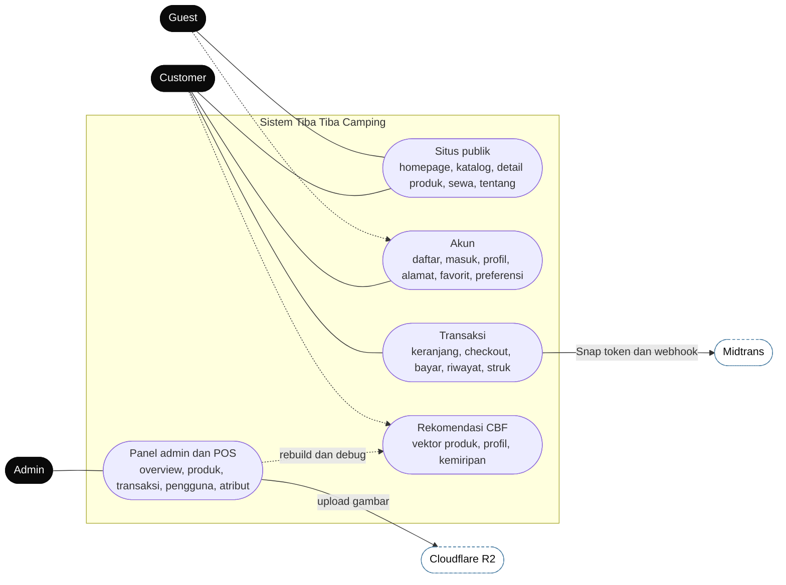
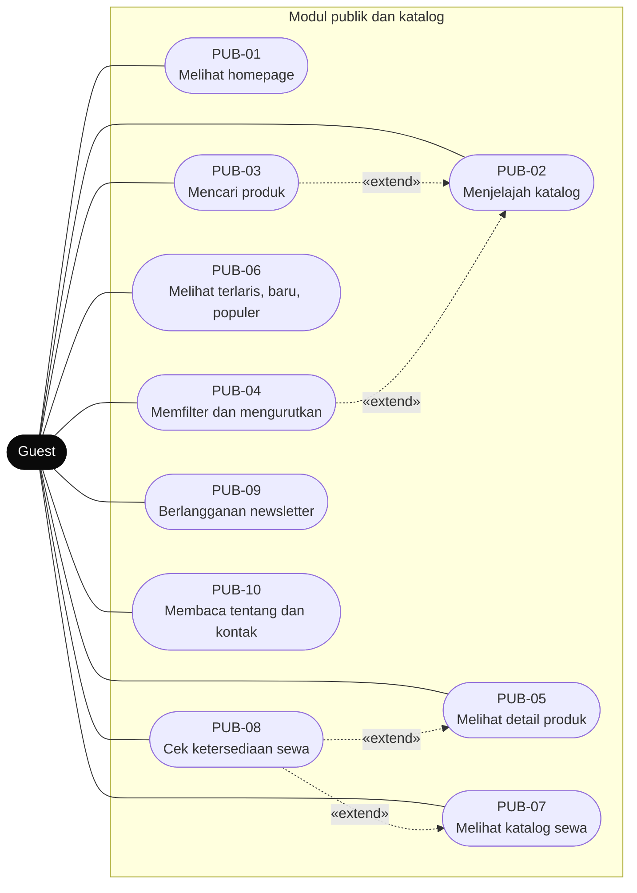
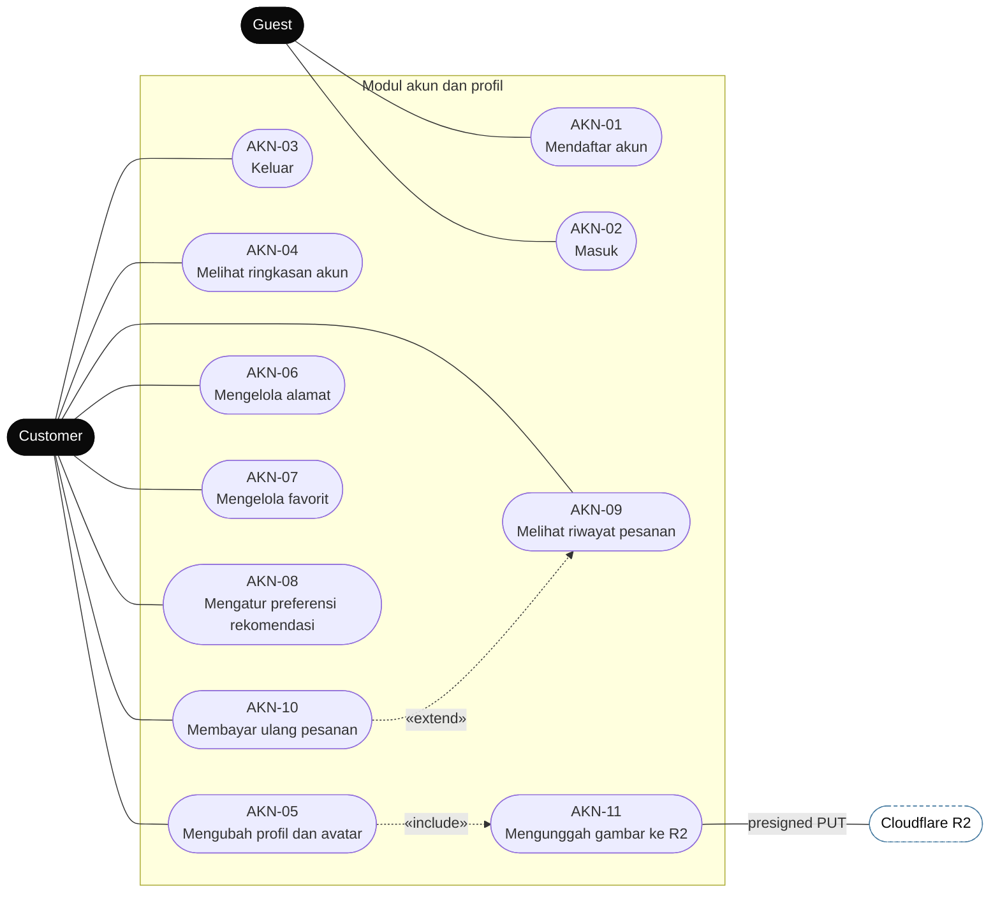
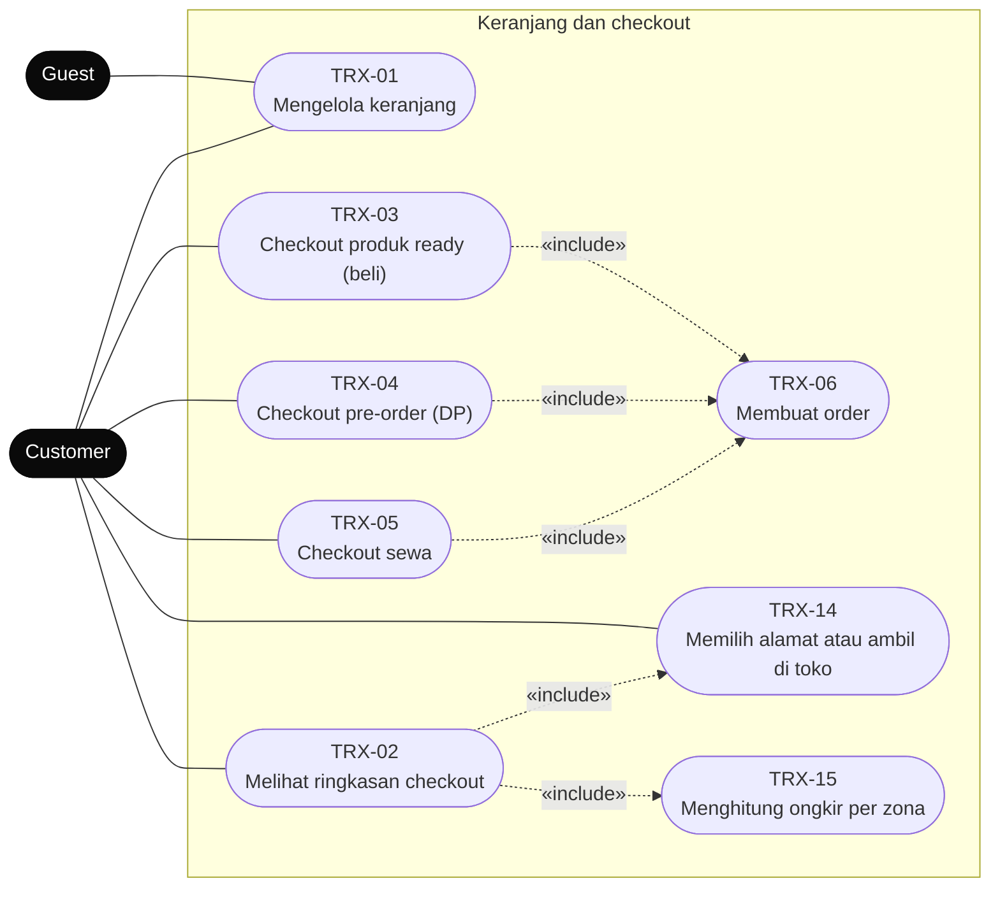
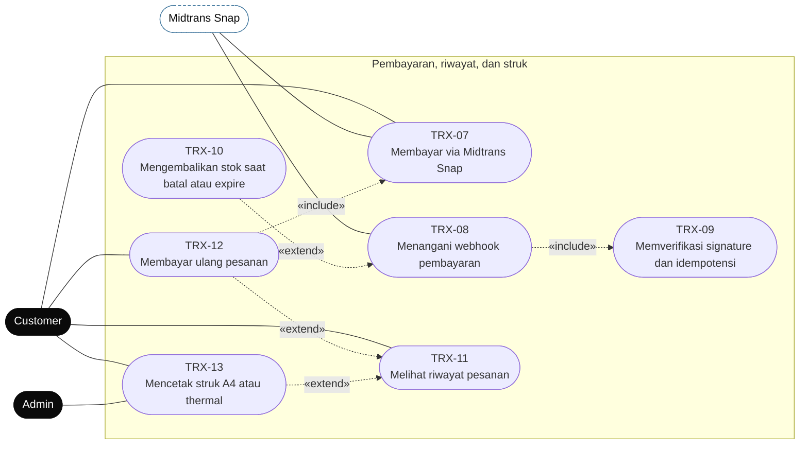
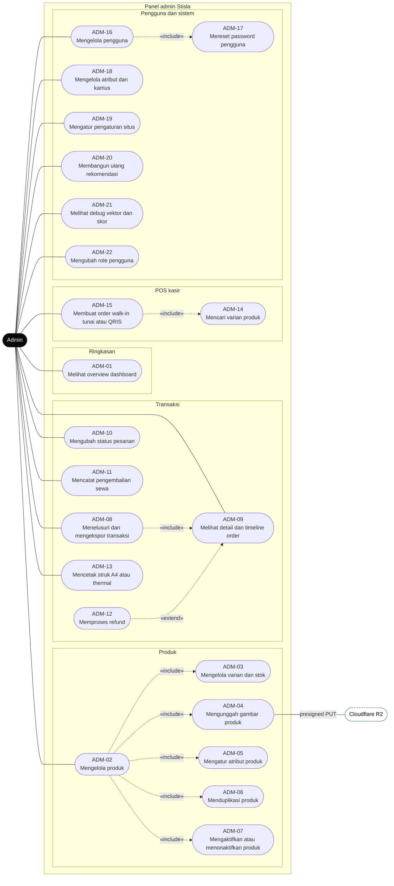
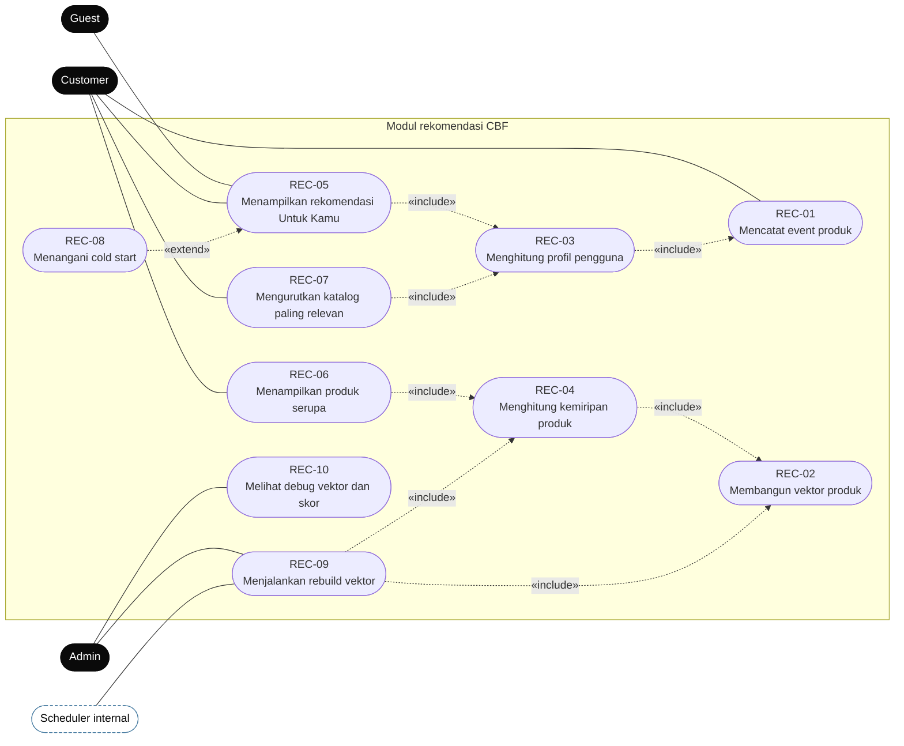
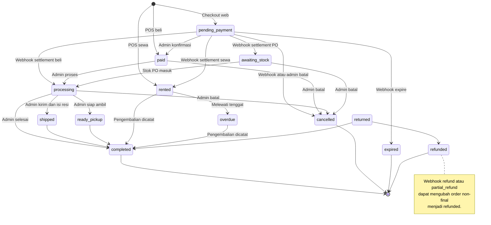
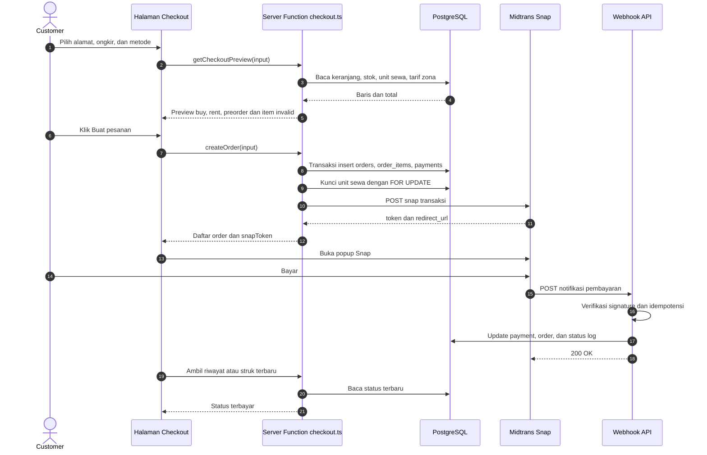

# Use Case Diagram — Tiba Tiba Camping

Dokumen ini memetakan **aktor**, **use case**, dan **relasinya** untuk aplikasi Tiba Tiba Camping
(e-commerce alat outdoor: beli, sewa, pre-order, rekomendasi CBF, panel admin + POS).

- **Sumber kebenaran fitur:** [`agents.md`](../agents.md), [`docs/decisions.md`](./decisions.md)
- **Sumber kebenaran implementasi:** `src/routes/**`, `src/server/fn/**`, `src/server/db/schema.ts`
- **Status:** sesuai implementasi saat ini (Oktober 2026)
- **Cara render:** GitHub/GitLab merender blok `mermaid` otomatis; di VS Code gunakan ekstensi
  _Markdown Preview Mermaid Support_, atau tempel ke <https://mermaid.live>.

> Mermaid tidak punya tipe diagram UML _use case_ khusus. Diagram di bawah memakai `flowchart`
> dengan bentuk **stadium** `([ ... ])` sebagai use case dan `classDef` sebagai pembeda aktor.
> Notasi tetap mengikuti UML: garis solid = asosiasi aktor, garis putus-putus = `«include»` /
> `«extend»`.

**Cakupan:** 68 use case dalam 5 modul — 10 publik/katalog, 11 akun, 15 transaksi,
22 admin/POS, dan 10 rekomendasi.

**Daftar isi**

1. [Aktor](#1-aktor)
2. [Peta use case](#2-peta-use-case-overview)
3. [Modul publik dan katalog](#3-modul-publik-dan-katalog)
4. [Akun, profil, dan preferensi](#4-akun-profil-dan-preferensi)
5. [Transaksi](#5-transaksi-keranjang-checkout-pembayaran-struk)
   - [Keranjang dan checkout](#51-keranjang-dan-checkout)
   - [Pembayaran, riwayat, dan struk](#52-pembayaran-riwayat-dan-struk)
6. [Panel admin dan POS](#6-panel-admin-dan-pos)
7. [Rekomendasi CBF](#7-rekomendasi-content-based-filtering-cbf)
8. [Status pesanan](#8-lampiran-a--status-pesanan)
9. [Urutan checkout dan webhook](#9-lampiran-b--urutan-checkout-dan-webhook)
10. [Matriks use case dan implementasi](#10-matriks-use-case-dan-implementasi)
11. [Aturan bisnis](#11-aturan-bisnis-yang-membatasi-use-case)

---

## 1. Aktor

| Aktor                           | Tipe                        | Hak akses ringkas                                                                                                                                                                   |
| ------------------------------- | --------------------------- | ----------------------------------------------------------------------------------------------------------------------------------------------------------------------------------- |
| **Guest**                       | Primer                      | Melihat homepage, katalog, detail produk, katalog sewa, mencari/memfilter, newsletter. Keranjang disimpan di cookie `ttc_cart`. Tidak bisa checkout, favorit, atau melihat pesanan. |
| **Customer**                    | Primer                      | Semua akses Guest, ditambah daftar/masuk, profil, alamat, favorit, preferensi rekomendasi, keranjang, checkout, pembayaran, riwayat pesanan, struk.                                 |
| **Admin**                       | Primer                      | Seluruh operasional: overview, produk & varian, gambar, transaksi, status order, pengembalian sewa, POS kasir, pengguna (termasuk mengubah role), atribut & kamus, pengaturan situs, rekomendasi.            |
| **Midtrans**                    | Sekunder (sistem eksternal) | Menerima pembuatan transaksi Snap, mengirim webhook notifikasi pembayaran.                                                                                                          |
| **Cloudflare R2**               | Sekunder (sistem eksternal) | Menerima upload gambar via presigned PUT URL; menyajikan gambar dari CDN.                                                                                                           |
| **Scheduler / sistem internal** | Sekunder                    | Menjalankan rebuild vektor rekomendasi (otomatis saat admin menyimpan, atau manual).                                                                                                |

**Generalisasi aktor:** `Customer` mewarisi semua use case `Guest`. Garis warisan tidak digambar
agar diagram tetap terbaca — hubungkan aktor turunan hanya ke use case tambahannya.

**Guard keamanan (bukan use case UI):**

- `requireAdmin()` → hanya `admin` (`src/server/fn/admin.ts`).
- `requireUser()` pada checkout, favorit, alamat, preferensi, pesanan, dan struk.
- Guard dicek di **server function**, bukan hanya `beforeLoad` route.

---

## 2. Peta use case (overview)

Rekomendasi tampil di homepage, detail produk, dan opsi sort katalog (lihat bagian 7).

---

## 3. Modul publik dan katalog

Catatan:

- Pencarian memperluas query memakai `pg_trgm` **dan** kamus sinonim/stopword dari admin
  (`src/server/fn/katalog.ts` → `expandSearchTerms`).
- Filter dan sort disimpan di URL search params dan divalidasi Zod (`src/lib/katalog-schema.ts`),
  sehingga tautan katalog bisa dibagikan.
- Sort **paling relevan** hanya untuk user login dan memakai skor rekomendasi — lihat REC-07.
- Detail produk menampilkan galeri, varian, stok, spesifikasi, favorit, serta **produk serupa**
  (REC-06).

---

## 4. Akun, profil, dan preferensi

Catatan:

- Login memakai **Better Auth** (email + password, session cookie httpOnly). Setelah login,
  admin diarahkan ke `/admin`, customer ke `/akun` (`src/routes/(public)/masuk.tsx`).
- Preferensi rekomendasi: kategori, budget, jumlah orang, kondisi/medan, gaya, dan mode
  beli/sewa/apa saja (`user_preferences`).
- Favorit bersifat idempoten per `(user, produk)`; toggle juga mencatat event rekomendasi.
- Avatar memakai presigned upload ke R2 (`src/server/fn/storage.ts`).

---

## 5. Transaksi: keranjang, checkout, pembayaran, struk

### 5.1 Keranjang dan checkout

Setelah `TRX-06` membuat order, alur berlanjut ke **TRX-07** (pembayaran) pada diagram berikutnya.

### 5.2 Pembayaran, riwayat, dan struk

Catatan penting:

- Checkout **wajib login** (`beforeLoad` route + `requireUser()` di server), tetapi keranjang guest
  tetap ada di cookie dan otomatis dipakai setelah login.
- Satu checkout dapat menghasilkan **maksimal 3 order** — `buy`, `rent`, `preorder` — karena item
  PO tidak dicampur dengan stok ready. Ongkir hanya dikenakan sekali.
- Stok dikurangi saat checkout; dipulihkan saat webhook `cancel` / `deny` / `expire` atau refund.
- Nomor order berformat `TTC-YYYYMMDD-XXXX`; struk bisa dibuka pemilik order atau admin.
- `TRX-09` memverifikasi SHA512 `order_id + status_code + gross_amount + server_key`; status dari
  client tidak pernah dipercaya.

---

## 6. Panel admin dan POS

Catatan:

- `ADM-22` mengubah role pengguna antara `customer` dan `admin`.
- `ADM-10` tunduk pada tabel transisi status. Contoh: `pending_payment` hanya boleh ke `paid` atau
  `cancelled`; `processing` boleh ke `shipped`, `ready_pickup`, `completed`, atau `cancelled`;
  status final tidak bisa diubah. Kirim barang **wajib** nomor resi.
- `ADM-11` mencatat `returned_at`, denda telat, biaya kerusakan, dan deposit yang dikembalikan;
  unit sewa dibebaskan dan order langsung menjadi `completed`.
- `ADM-15` membuat order POS berstatus `paid` (beli) atau `rented` (sewa), mengurangi stok /
  mengunci unit sewa, mencatat baris `payments`, lalu bisa langsung mencetak struk thermal.
- Setiap aksi sensitif admin ditulis ke `audit_logs` (status order, produk, pengguna, POS, refund).

---

## 7. Rekomendasi Content-Based Filtering (CBF)

Catatan:

- Event yang dicatat: `view`, `add_cart`, `favorite`. Sinyal pembelian (`purchase`) diambil dari
  `order_items` pada order yang sudah selesai, bukan dari tabel event.
- Profil user = rata-rata berbobot vektor produk (beli 1.0, sewa 0.8, favorit 0.7, add_cart 0.4,
  view 0.2) + preferensi eksplisit ×1.0, dengan _time decay_ half-life 90 hari.
- Vektor produk = TF-IDF teks (setelah normalisasi kamus) + fitur numerik yang dinormalisasi,
  dikali bobot atribut dari admin. Disimpan padat di `product_vectors`.
- Kemiripan item-item = cosine similarity, diprekomputasi top-N ke `product_similarity`.
- Cold start (guest / user tanpa histori) memakai produk populer lalu terbaru; alasan kartu hanya
  `personal`, `popular`, atau `baru`.
- Bila user sudah pernah membeli produk, produk itu tidak direkomendasikan lagi; hasil dibatasi
  maksimal 3 produk per kategori pada setiap pengambilan.
- Rebuild dipicu otomatis (non-blocking) saat admin menyimpan produk/atribut/kamus, dan tersedia
  tombol manual di `/admin/rekomendasi`. Halaman debug menampilkan vektor dan skor per produk.

---

## 8. Lampiran A — Status pesanan

Catatan: `returned` hanya dipertahankan untuk data lama; alur baru mencatat pengembalian lalu
langsung mengubah status menjadi `completed` (`docs/decisions.md` #33).

---

## 9. Lampiran B — Urutan checkout dan webhook

---

## 10. Matriks use case dan implementasi

### 10.1 Publik dan katalog

| ID     | Use case                        | Aktor           | Implementasi utama                                                            |
| ------ | ------------------------------- | --------------- | ----------------------------------------------------------------------------- |
| PUB-01 | Melihat homepage                | Guest, Customer | `src/routes/(public)/index.tsx`, `src/components/site/*`                      |
| PUB-02 | Menjelajah katalog              | Guest, Customer | `src/routes/(public)/katalog/index.tsx`                                       |
| PUB-03 | Mencari produk                  | Guest, Customer | `src/server/fn/katalog.ts` (`searchProducts`, `expandSearchTerms`)            |
| PUB-04 | Memfilter dan mengurutkan       | Guest, Customer | `src/lib/katalog-schema.ts`, `src/server/fn/katalog.ts`                       |
| PUB-05 | Melihat detail produk           | Guest, Customer | `src/routes/(public)/produk/$slug.tsx`, `src/server/fn/product.ts`            |
| PUB-06 | Melihat terlaris, baru, populer | Guest, Customer | `src/server/fn/product.ts` (`getBestSellers`, `getNewArrivals`, `getPopular`) |
| PUB-07 | Melihat katalog sewa            | Guest, Customer | `src/routes/(public)/sewa.tsx`, `src/server/fn/rental.ts`                     |
| PUB-08 | Cek ketersediaan sewa           | Guest, Customer | `checkRentalAvailability` di `src/server/fn/rental.ts`                        |
| PUB-09 | Berlangganan newsletter         | Guest           | `src/server/fn/newsletter.ts`, `src/components/site/Newsletter.tsx`           |
| PUB-10 | Membaca tentang dan kontak      | Guest           | `src/routes/(public)/tentang.tsx`, `src/server/fn/settings.ts`                |

### 10.2 Akun dan profil

| ID     | Use case                        | Aktor    | Implementasi utama                                    |
| ------ | ------------------------------- | -------- | ----------------------------------------------------- |
| AKN-01 | Mendaftar akun                  | Guest    | `src/routes/(public)/daftar.tsx`, `src/lib/auth.ts`   |
| AKN-02 | Masuk                           | Guest    | `src/routes/(public)/masuk.tsx`                       |
| AKN-03 | Keluar                          | Customer | `logout` di `src/server/fn/auth.ts`                   |
| AKN-04 | Melihat ringkasan akun          | Customer | `src/routes/(public)/akun/index.tsx`                  |
| AKN-05 | Mengubah profil dan avatar      | Customer | `updateProfile` di `src/server/fn/account.ts`         |
| AKN-06 | Mengelola alamat                | Customer | `saveAddress`, `deleteAddress`, `listAddresses`       |
| AKN-07 | Mengelola favorit               | Customer | `toggleFavorite`, `getFavorites`                      |
| AKN-08 | Mengatur preferensi rekomendasi | Customer | `savePreferences`, `getRecommendationProfile`         |
| AKN-09 | Melihat riwayat pesanan         | Customer | `src/routes/(public)/akun/pesanan.tsx`, `getMyOrders` |
| AKN-10 | Membayar ulang pesanan          | Customer | `repayOrder` di `src/server/fn/checkout.ts`           |
| AKN-11 | Mengunggah gambar ke R2         | Customer | `getAvatarUploadUrl` di `src/server/fn/storage.ts`    |

### 10.3 Transaksi

| ID     | Use case                             | Aktor              | Implementasi utama                                         |
| ------ | ------------------------------------ | ------------------ | ---------------------------------------------------------- |
| TRX-01 | Mengelola keranjang                  | Guest, Customer    | `src/server/fn/cart.ts`, cookie `ttc_cart`                 |
| TRX-02 | Melihat ringkasan checkout           | Customer           | `getCheckoutPreview` di `src/server/fn/checkout.ts`        |
| TRX-03 | Checkout produk ready                | Customer           | `createOrder` (grup `buy`)                                 |
| TRX-04 | Checkout pre-order                   | Customer           | `createOrder` (grup `preorder`), `src/lib/order-totals.ts` |
| TRX-05 | Checkout sewa                        | Customer           | `createOrder` (grup `rent`), `pickRentUnits`               |
| TRX-06 | Membuat order                        | Customer           | `createOrder`, `orderCode()`, transaksi DB                 |
| TRX-07 | Membayar via Midtrans Snap           | Customer, Midtrans | `createSnap`, `repayOrder`                                 |
| TRX-08 | Menangani webhook pembayaran         | Midtrans           | `src/routes/api/midtrans/notification.ts`                  |
| TRX-09 | Verifikasi signature dan idempotensi | Sistem             | `verifyMidtransSignature`, `processMidtransNotification`   |
| TRX-10 | Mengembalikan stok saat batal/expire | Sistem             | `restockBuyOrder`, `RESTOCK_FROM`                          |
| TRX-11 | Melihat riwayat pesanan              | Customer           | `getMyOrders` di `src/server/fn/order.ts`                  |
| TRX-12 | Membayar ulang pesanan               | Customer           | `repayOrder`                                               |
| TRX-13 | Mencetak struk A4/thermal            | Customer, Admin    | `src/routes/struk/$code.tsx`, `src/server/fn/receipt.ts`   |
| TRX-14 | Memilih alamat atau ambil di toko    | Customer           | `getCheckoutPreview`, tabel `addresses`                    |
| TRX-15 | Menghitung ongkir per zona           | Sistem             | `shippingFee` di `src/server/fn/checkout.ts`               |

### 10.4 Admin dan POS

| ID     | Use case                            | Aktor | Implementasi utama                                         |
| ------ | ----------------------------------- | ----- | ---------------------------------------------------------- |
| ADM-01 | Melihat overview dashboard          | Admin | `src/routes/admin/index.tsx`, `getAdminOverview`           |
| ADM-02 | Mengelola produk                    | Admin | `src/routes/admin/produk/*`, `saveProduct`                 |
| ADM-03 | Mengelola varian dan stok           | Admin | `saveVariant`, `deleteVariant`                             |
| ADM-04 | Mengunggah gambar produk            | Admin | `addProductImage`, `getR2UploadUrl`                        |
| ADM-05 | Mengatur atribut produk             | Admin | `saveProductAttributes`                                    |
| ADM-06 | Menduplikasi produk                 | Admin | `duplicateProduct`                                         |
| ADM-07 | Mengaktifkan/menonaktifkan produk   | Admin | `toggleProductActive`                                      |
| ADM-08 | Menelusuri dan mengekspor transaksi | Admin | `getAdminOrders`, `exportAdminOrders`                      |
| ADM-09 | Melihat detail dan timeline order   | Admin | `getAdminOrder`, `order_status_logs`                       |
| ADM-10 | Mengubah status pesanan             | Admin | `updateOrderStatus`, `ORDER_TRANSITIONS`                   |
| ADM-11 | Mencatat pengembalian sewa          | Admin | `returnRental`, `returnRentalCore`                         |
| ADM-12 | Memproses refund                    | Admin | `updateOrderStatus` ke `refunded`, webhook refund          |
| ADM-13 | Mencetak struk                      | Admin | `/struk/$code?paper=thermal&print=true`                    |
| ADM-14 | Mencari varian produk               | Admin | `searchPosVariants`                                        |
| ADM-15 | Membuat order walk-in               | Admin | `createPosOrder`, `createPosOrderCore`                     |
| ADM-16 | Mengelola pengguna                  | Admin | `getAdminUsers`, `setUserActive`                           |
| ADM-17 | Mereset password pengguna           | Admin | `resetUserPassword`                                        |
| ADM-18 | Mengelola atribut dan kamus         | Admin | `getAttributes`, `saveAttribute`, `saveTerm`, `deleteTerm` |
| ADM-19 | Mengatur pengaturan situs           | Admin | `updateSiteSettings`, `src/routes/admin/pengaturan.tsx`    |
| ADM-20 | Membangun ulang rekomendasi         | Admin | `rebuildRecommenderNow`, `scheduleRebuild`                 |
| ADM-21 | Melihat debug vektor dan skor       | Admin | `getRecommenderStats`, `getRecommenderProductDebug`        |
| ADM-22 | Mengubah role pengguna              | Admin | `setUserRole`, `requireAdmin`                              |

### 10.5 Rekomendasi

| ID     | Use case                           | Aktor            | Implementasi utama                                          |
| ------ | ---------------------------------- | ---------------- | ----------------------------------------------------------- |
| REC-01 | Mencatat event produk              | Sistem           | `recordProductEvent` di `src/server/recommender/profile.ts` |
| REC-02 | Membangun vektor produk            | Sistem           | `src/server/recommender/vectorize.ts`                       |
| REC-03 | Menghitung profil pengguna         | Sistem           | `profile.ts`, tabel `user_profile_vectors`                  |
| REC-04 | Menghitung kemiripan produk        | Sistem           | `similarity.ts`, `product_similarity`                       |
| REC-05 | Menampilkan rekomendasi Untuk Kamu | Guest, Customer  | `getRecommendations`, `pickForUser`                         |
| REC-06 | Menampilkan produk serupa          | Customer         | `getRelatedProducts`                                        |
| REC-07 | Mengurutkan katalog paling relevan | Customer         | `rankActiveProductIds` di `src/server/fn/recommend.ts`      |
| REC-08 | Menangani cold start               | Sistem           | `pickForUser` (alasan `popular` / `baru`)                   |
| REC-09 | Menjalankan rebuild vektor         | Admin, Scheduler | `rebuildRecommenderNow`, `scheduleRebuild`                  |
| REC-10 | Melihat debug vektor dan skor      | Admin            | `src/routes/admin/rekomendasi.tsx`                          |

---

## 11. Aturan bisnis yang membatasi use case

1. **Checkout wajib login.** Keranjang guest tetap tersimpan di cookie dan dilanjutkan otomatis.
2. **Maksimal 3 order per checkout** (`buy`, `rent`, `preorder`), karena item PO tidak boleh
   dicampur dengan stok ready.
3. **Ongkir sekali per checkout** — dikenakan pada order `buy`, atau `rent` bila tidak ada `buy`;
   PO tidak dikenai ongkir.
4. **Stok** dikurangi saat checkout dan dipulihkan saat pembayaran batal/expire/refund.
5. **Unit sewa** dikunci dengan `SELECT … FOR UPDATE` dan cek tumpang tindih periode; deposit 50%
   dari subtotal sewa per order.
6. **Denda sewa** = `late_days × harga sewa harian`, dihitung memakai tanggal kalender
   `Asia/Jakarta`; deposit dikembalikan setelah unit diperiksa.
7. **Status order** hanya boleh berpindah sesuai `ORDER_TRANSITIONS`; status final tidak bisa
   diubah. Transisi ke `shipped` wajib nomor resi.
8. **Pembayaran** diverifikasi lewat signature webhook, bukan status dari client. Notifikasi
   idempoten dan `raw_notification` disimpan untuk audit.
9. **Struk** hanya bisa diakses pemilik order atau admin; struk belum lunas diberi watermark
   "BELUM DIBAYAR".
10. **Admin guard ada di server** (`requireAdmin`), bukan hanya di UI.
11. **Rekomendasi tidak memakai data user lain** (bukan collaborative filtering); produk yang sudah
    dibeli disaring, hasil didiversifikasi maksimal 3 per kategori.
